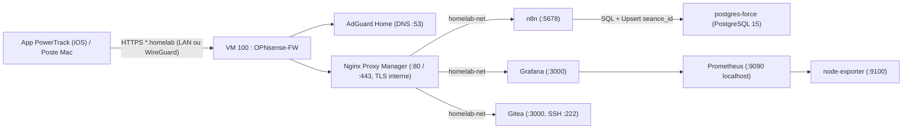

# Homelab Infrastructure & PowerTrack Pipeline

Dépôt Infrastructure-as-Code et documentation du homelab personnel hébergé sous **Proxmox VE**, combinant pare-feu/VPN (**OPNsense + WireGuard**), services Docker auto-hébergés sur **`Serveur-Linux` (VM 101)** et le pipeline d'analyse d'entraînement de l'application iOS **PowerTrack** (`n8n` → `PostgreSQL 15` → `Grafana` / `MCP`).

> **Note de sécurité :** Ce dépôt ne contient aucun secret, mot de passe, clé API, certificat privé, ni export de base de données. Les fichiers sensibles (`.env`, `*.key`, `*.crt`, `*.sqlite`, `*.dump`, `*.tar.gz`) sont bloqués par `.gitignore`.

---

## Architecture globale

---

## Services et domaines internes (`*.homelab`)

| Service | Conteneur / Hôte | Domaine SAN | Rôle | Statut |
| :--- | :--- | :--- | :--- | :--- |
| Reverse Proxy | `nginx-proxy-manager` | `npm.homelab` | Terminaison TLS & routage HTTPS (`127.0.0.1:81` pour l'admin) | Actif |
| DNS local | `adguard-home` | `adguard.homelab` | Résolution `*.homelab` et filtrage DNS (`:53`) | Actif |
| Automatisation | `n8n` | `n8n.homelab` | Webhooks PowerTrack (`POST` ingestion / `GET` coach summary) | Actif |
| Base de données | `postgres-force` | *(réseau interne `homelab-net`)* | PostgreSQL 15 (`powertrack`, `db_entrainement`), non exposé hors Docker | Actif |
| Visualisation | `grafana` | `grafana.homelab` | Tableaux de bord système & entraînement | Actif |
| Métriques | `prometheus` / `node-exporter` | `prometheus.homelab` | Collecte métriques hôte (`127.0.0.1:9090` côté hôte) | Actif |
| Forge Git | `gitea` | `gitea.homelab` | Dépôts Git locaux (SSH sur port `222`) | Actif |
| BI / Exploration | `metabase` | `metabase.homelab` | Exploration SQL (`restart: "no"`, démarré à la demande) | À la demande |
| Pare-feu / VPN | VM 100 (`OPNsense-FW`) | `opnsense.homelab` | Routage, pare-feu et tunnel WireGuard | Actif |
| Hyperviseur | Hôte Proxmox VE | `proxmox.homelab` | Virtualisation KVM et snapshots `vzdump` | Actif |
| SideStore helper | `anisette` | `anisette.homelab` | Serveur Anisette v3 (`:6969`, arrêté pour usage distant) | Optionnel (arrêté) |

---

## Structure du dépôt et correspondance serveur

| Chemin dans ce dépôt | Emplacement réel sur l'infrastructure | Description |
| :--- | :--- | :--- |
| [`stacks/core/docker-compose.yml`](stacks/core/docker-compose.yml) | `/home/ethan/docker-compose.yml` | Réseau `homelab-net`, Nginx Proxy Manager et AdGuard Home |
| [`stacks/carnet-force/docker-compose.yml`](stacks/carnet-force/docker-compose.yml) | `/home/ethan/carnet-force/docker-compose.yml` | Stack PostgreSQL 15 (`postgres-force`) et Metabase |
| [`stacks/carnet-force/.env.example`](stacks/carnet-force/.env.example) | `/home/ethan/carnet-force/.env` *(non suivi)* | Modèle de variables d'environnement PostgreSQL |
| [`stacks/carnet-force/init-powertrack.sql`](stacks/carnet-force/init-powertrack.sql) | `/home/ethan/carnet-force/init-powertrack.sql` | Schéma SQL, fonctions d'upsert, alertes et vues PowerTrack |
| [`stacks/monitoring/`](stacks/monitoring/docker-compose.yml) | `/home/ethan/monitoring/` | Prometheus, Grafana et Node Exporter |
| [`stacks/n8n/docker-compose.yml`](stacks/n8n/docker-compose.yml) | `/home/ethan/n8n-docker/docker-compose.yml` | Service `n8n` derrière `https://n8n.homelab/` |
| [`stacks/n8n/workflows/`](stacks/n8n/workflows/powertrack-post.json) | Base `n8n` (exports nettoyés) | Workflows PowerTrack `POST` et `GET` |
| [`stacks/gitea/docker-compose.yml`](stacks/gitea/docker-compose.yml) | `/home/ethan/gitea-docker/docker-compose.yml` | Forge Gitea interne |
| [`stacks/anisette/docker-compose.yml`](stacks/anisette/docker-compose.yml) | `/home/ethan/anisette-docker/docker-compose.yml` | Conteneur `anisette-v3-server` (optionnel) |
| [`pki/`](pki/ca.cnf) | `/home/ethan/homelab-ca/` | Modèles OpenSSL Root CA (`ca.cnf`) et certificat SAN (`leaf.cnf`) |
| [`backups/homelab-backup.sh`](backups/homelab-backup.sh) | `/usr/local/sbin/homelab-backup.sh` | Script de sauvegarde logique quotidienne (VM 101) |
| [`backups/systemd/`](backups/systemd/homelab-backup.timer) | `/etc/systemd/system/` | Unité `oneshot` et timer quotidien `03:30` UTC |
| [`backups/proxmox/jobs.cfg`](backups/proxmox/jobs.cfg) | `/etc/pve/jobs.cfg` *(hôte Proxmox)* | Tâche hebdomadaire `vzdump` des VM 100 et 101 |

---

## Documentation détaillée

- [Architecture réseau, PKI et pipeline PowerTrack](docs/architecture.md)
- [Stratégie de sauvegarde et procédures de restauration](docs/backup-restore.md)

---

## Déploiement / Recréation de l'environnement

1. Créer les fichiers `.env` requis à partir des modèles (ex. `cp stacks/carnet-force/.env.example .env`) avec des secrets générés localement.
2. Démarrer d'abord la stack cœur (`stacks/core/docker-compose.yml`) pour initialiser le réseau Docker partagé `homelab-net`.
3. Démarrer ensuite les stacks dépendantes (`carnet-force`, `n8n`, `monitoring`, `gitea`).
4. Initialiser la base `powertrack` dans `postgres-force` à l'aide de [`init-powertrack.sql`](stacks/carnet-force/init-powertrack.sql), créer le rôle lecture seule `powertrack_ro`, puis importer les workflows `n8n` en rattachant les identifiants dans l'interface `n8n` (`PowerTrack API Key` et `Postgres PowerTrack`).
5. Générer la PKI privée à partir de [`pki/ca.cnf`](pki/ca.cnf) et [`pki/leaf.cnf`](pki/leaf.cnf), importer la paire certificat/clé feuille dans Nginx Proxy Manager et installer uniquement le certificat racine public (`homelab-root-ca.crt`) sur les appareils clients.
