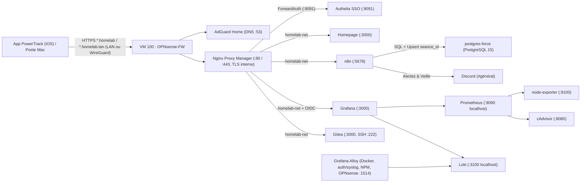

# Homelab Infrastructure & PowerTrack Pipeline

Dépôt Infrastructure-as-Code et documentation du homelab personnel hébergé sous **Proxmox VE**, combinant pare-feu/VPN (**OPNsense + WireGuard**), services Docker auto-hébergés sur **`Serveur-Linux` (VM 101)** et le pipeline d'analyse d'entraînement de l'application iOS **PowerTrack** (`n8n` → `PostgreSQL 15` → `Grafana` / `MCP`).

> **Note de sécurité :** Ce dépôt ne contient aucun secret, mot de passe, clé API, certificat privé, ni export de base de données. Les fichiers sensibles (`.env`, `*.key`, `*.crt`, `*.sqlite`, `*.dump`, `*.tar.gz`) sont bloqués par `.gitignore`.

---

## Architecture globale

---

## Services et domaines internes (`*.homelab` & `*.homelab.lan`)

| Service | Conteneur / Hôte | Domaine SAN | Rôle | Statut |
| :--- | :--- | :--- | :--- | :--- |
| Portail SSO / OIDC | `authelia` | `auth.homelab.lan` | Authentification centralisée (`ForwardAuth` NPM + fournisseur OIDC PKCE) | Actif |
| Portail d'accueil | `homepage` | `home.homelab.lan` *(redirection depuis `homelab`)* | Page d'accueil centralisée & widgets en direct (protégé par Authelia) | Actif |
| Reverse Proxy | `nginx-proxy-manager` | `npm.homelab` | Terminaison TLS, `auth_request` Authelia & routage HTTPS (`127.0.0.1:81`) | Actif |
| DNS local | `adguard-home` | `adguard.homelab` | Résolution `*.homelab` / `*.homelab.lan` et filtrage DNS (`:53`) | Actif |
| Automatisation | `n8n` | `n8n.homelab` | Webhooks PowerTrack (`POST`/`GET`), surveillance services, alertes backup, veille vocale & radar stages/alternance | Actif |
| Radar Carrière | `homelab-carriere` | `carriere.homelab.lan` *(redirection depuis `carriere.homelab`)* | Suivi candidatures (offres, entreprises ≤ 30 min IGN) & export Excel (`.xlsx`, protégé par Authelia) | Actif |
| Synthèse vocale | `homelab-tts` | *(réseau interne `homelab-net`)* | Sidecar Python/FFmpeg de conversion PCM → OGG Opus & upload vocal Discord pour `n8n` (contient aussi Piper local optionnel) | Actif |
| Base de données | `postgres-force` | *(réseau interne `homelab-net`)* | PostgreSQL 15 (`powertrack`, `carriere`, `db_entrainement`), non exposé hors Docker | Actif |
| Visualisation | `grafana` | `grafana.homelab.lan` *(redirection depuis `grafana.homelab`)* | Dashboards système (`Node Exporter`), conteneurs (`cAdvisor`), logs/sécurité (`Loki`) + SSO OIDC Authelia | Actif |
| Centralisation logs | `loki` / `alloy` | *(réseau interne `homelab-net`)* | Collecte et indexation des logs (Docker, SSH/auth, Fail2ban, NPM, Syslog OPNsense `:1514`), rétention 14 j | Actif |
| Métriques | `prometheus` / `node-exporter` / `cadvisor` | `prometheus.homelab.lan` *(redirection depuis `prometheus.homelab`)* | Collecte métriques hôte et conteneurs Docker (protégé par Authelia) | Actif |
| Forge Git | `gitea` | `gitea.homelab` | Dépôts Git locaux (SSH sur port `222`) | Actif |
| BI / Exploration | `metabase` | `metabase.homelab` | Exploration SQL (`restart: "no"`, démarré à la demande) | À la demande |
| Pare-feu / VPN | VM 100 (`OPNsense-FW`) | `opnsense.homelab` | Routage, pare-feu et tunnel WireGuard | Actif |
| Hyperviseur | Hôte Proxmox VE | `proxmox.homelab` | Virtualisation KVM et snapshots `vzdump` | Actif |
| SideStore helper | `anisette` | `anisette.homelab` | Serveur Anisette v3 (`:6969`, arrêté pour usage distant) | Optionnel (arrêté) |

---

## Structure du dépôt et correspondance serveur

| Chemin dans ce dépôt | Emplacement réel sur l'infrastructure | Description |
| :--- | :--- | :--- |
| [`stacks/core/docker-compose.yml`](stacks/core/docker-compose.yml) | `/home/ethan/docker-compose.yml` | Réseau `homelab-net`, Nginx Proxy Manager et AdGuard Home |
| [`stacks/core/npm-custom/`](stacks/core/npm-custom/authelia-location.conf) | `/home/ethan/npm/data/nginx/custom/` | Snippets Nginx `auth_request` partagés (`authelia-location.conf`, `authelia-authrequest.conf`) |
| [`stacks/authelia/`](stacks/authelia/docker-compose.yml) | `/home/ethan/authelia-docker/` | Portail SSO **Authelia** (`auth.homelab.lan`), fournisseur OIDC PKCE (secrets/users hors Git) |
| [`stacks/carnet-force/docker-compose.yml`](stacks/carnet-force/docker-compose.yml) | `/home/ethan/carnet-force/docker-compose.yml` | Stack PostgreSQL 15 (`postgres-force`) et Metabase |
| [`stacks/carnet-force/.env.example`](stacks/carnet-force/.env.example) | `/home/ethan/carnet-force/.env` *(non suivi)* | Modèle de variables d'environnement PostgreSQL |
| [`stacks/carnet-force/init-powertrack.sql`](stacks/carnet-force/init-powertrack.sql) | `/home/ethan/carnet-force/init-powertrack.sql` | Schéma SQL, fonctions d'upsert, alertes et vues PowerTrack |
| [`stacks/monitoring/`](stacks/monitoring/docker-compose.yml) | `/home/ethan/monitoring/` | Prometheus, Grafana (avec provisioning Loki), Loki, Grafana Alloy (`config.alloy`), Node Exporter et cAdvisor |
| [`stacks/n8n/docker-compose.yml`](stacks/n8n/docker-compose.yml) | `/home/ethan/n8n-docker/docker-compose.yml` | Service `n8n` derrière `https://n8n.homelab/` |
| [`stacks/n8n/workflows/`](stacks/n8n/workflows/powertrack-post.json) | Base `n8n` (exports nettoyés) | Workflows PowerTrack, alertes Discord, veille vocale & radar stages/alternance |
| [`stacks/carriere/`](stacks/carriere/docker-compose.yml) | `/home/ethan/carriere-docker/` | App web FastAPI `homelab-carriere` (`carriere.homelab`), collecteurs d'offres/entreprises & export Excel |
| [`stacks/tts/`](stacks/tts/docker-compose.yml) | `/home/ethan/tts-docker/` | Sidecar `homelab-tts` (conversion PCM → OGG Opus, waveform & upload Discord) |
| [`stacks/gitea/docker-compose.yml`](stacks/gitea/docker-compose.yml) | `/home/ethan/gitea-docker/docker-compose.yml` | Forge Gitea interne |
| [`stacks/homepage/`](stacks/homepage/docker-compose.yml) | `/home/ethan/homepage-docker/` | Page d'accueil Homepage, `.env.example` et fichiers YAML |
| [`stacks/anisette/docker-compose.yml`](stacks/anisette/docker-compose.yml) | `/home/ethan/anisette-docker/docker-compose.yml` | Conteneur `anisette-v3-server` (optionnel) |
| [`pki/`](pki/ca.cnf) | `/home/ethan/homelab-ca/` | Modèles OpenSSL Root CA (`ca.cnf`) et certificat SAN (`leaf.cnf`) |
| [`backups/homelab-backup.sh`](backups/homelab-backup.sh) | `/usr/local/sbin/homelab-backup.sh` | Script de sauvegarde logique quotidienne (VM 101) |
| [`backups/homelab-health-alert.sh`](backups/homelab-health-alert.sh) | `/usr/local/sbin/homelab-health-alert.sh` | Contrôle quotidien (backup, TLS, disque), alertes `OnFailure`, bannissements Fail2ban & scan LogQL Loki |
| [`backups/systemd/`](backups/systemd/homelab-backup.timer) | `/etc/systemd/system/` | Services & timers (`03:30` backup, `08:00` santé, toutes les `5 min` veille sécurité Loki) |
| [`backups/proxmox/jobs.cfg`](backups/proxmox/jobs.cfg) | `/etc/pve/jobs.cfg` *(hôte Proxmox)* | Tâche hebdomadaire `vzdump` des VM 100 et 101 |
| [`system/51homelab-unattended`](system/51homelab-unattended) | `/etc/apt/apt.conf.d/51homelab-unattended` | Mises à jour de sécurité APT automatiques (sans reboot auto) |
| [`system/fail2ban/`](system/fail2ban/homelab-ssh.local) | `/etc/fail2ban/` | Protection SSH `sshd` (`nftables`, ban 1 h après 5 échecs) & action alerte Discord |
| [`system/hardening/`](system/hardening/10-homelab-hardening.conf) | `/etc/ssh/sshd_config.d/`, `/etc/sysctl.d/`, `/etc/modprobe.d/` | Durcissement système aligné Lynis (SSH par clé, sysctl noyau/réseau, modprobe, core dumps) |
| [`.github/workflows/devsecops.yml`](.github/workflows/devsecops.yml) | *(GitHub Actions CI)* | Pipeline DevSecOps : Gitleaks, ShellCheck, validation JSON/YAML/Compose et scan Trivy |

---

## Documentation détaillée

- [Architecture réseau, PKI et pipeline PowerTrack](docs/architecture.md)
- [Stratégie de sauvegarde et procédures de restauration](docs/backup-restore.md)
- [Audit sécurité Lynis & pipeline DevSecOps CI](docs/security-hardening.md)

---

## Déploiement / Recréation de l'environnement

1. Créer les fichiers `.env` requis à partir des modèles (ex. `cp stacks/carnet-force/.env.example .env`) avec des secrets générés localement.
2. Démarrer d'abord la stack cœur (`stacks/core/docker-compose.yml`) pour initialiser le réseau Docker partagé `homelab-net`.
3. Démarrer ensuite les stacks dépendantes (`carnet-force`, `n8n`, `monitoring`, `gitea`).
4. Initialiser la base `powertrack` dans `postgres-force` à l'aide de [`init-powertrack.sql`](stacks/carnet-force/init-powertrack.sql), créer le rôle lecture seule `powertrack_ro`, puis importer les workflows `n8n` en rattachant les identifiants dans l'interface `n8n` (`PowerTrack API Key` et `Postgres PowerTrack`).
5. Générer la PKI privée à partir de [`pki/ca.cnf`](pki/ca.cnf) et [`pki/leaf.cnf`](pki/leaf.cnf), importer la paire certificat/clé feuille dans Nginx Proxy Manager et installer uniquement le certificat racine public (`homelab-root-ca.crt`) sur les appareils clients.
