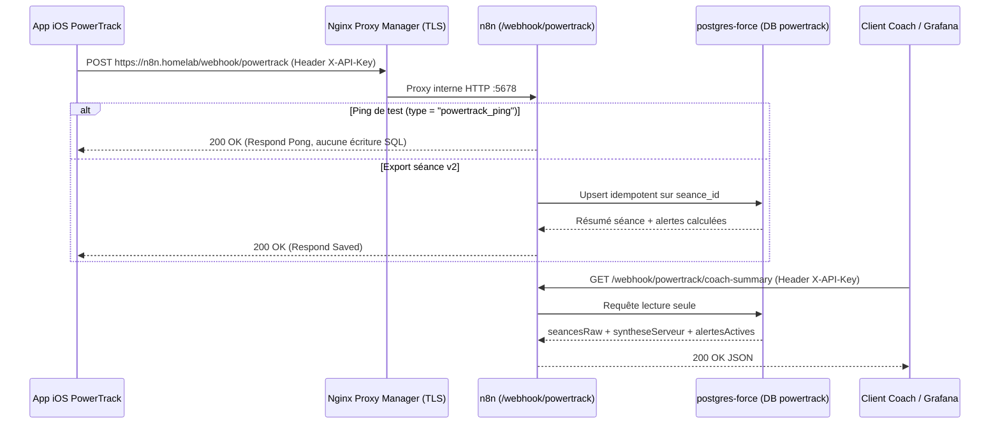

# Architecture du Homelab

## 1. Machines virtuelles Proxmox VE

| VMID | Nom | Rôle | RAM allouée | Disque système |
| :---: | :--- | :--- | :---: | :---: |
| `100` | `OPNsense-FW` | Pare-feu, routage inter-réseaux et serveur VPN WireGuard | 2 Go | 32 Go |
| `101` | `Serveur-Linux` | Hôte Ubuntu / Docker hébergeant l'ensemble des stacks applicatives | 4 Go | 50 Go |

---

## 2. Réseau, DNS et chiffrement TLS interne

### Réseau Docker partagé (`homelab-net`)
- Le réseau bridge `homelab-net` est déclaré par [`stacks/core/docker-compose.yml`](../stacks/core/docker-compose.yml) et consommé en tant que `external: true` par les autres stacks.
- **Isolation PostgreSQL :** Le conteneur `postgres-force` n'expose pas le port `5432` sur l'hôte Linux. Seuls les conteneurs membres de `homelab-net` (`n8n`, `metabase`, etc.) peuvent s'y connecter en interne.
- **Interfaces d'administration restreintes :** L'interface Web de Nginx Proxy Manager (`:81`) et celle de Prometheus (`:9090`) ne sont bindées que sur `127.0.0.1` côté hôte et sont accessibles via reverse proxy HTTPS ou tunnel SSH.

### Résolution DNS et PKI privée (`*.homelab`)
1. **DNS (`adguard-home`) :** Résout les noms de domaine internes `*.homelab` sur le réseau local et à travers le tunnel WireGuard.
2. **Autorité de certification interne (`pki/ca.cnf`) :** Définit l'autorité racine `Ethan Homelab Root CA` (`C = FR`, `O = Homelab`). La clé privée de la CA reste strictement hors Git sur le serveur.
3. **Certificat serveur multi-domaines (`pki/leaf.cnf`) :** Couvre les SAN suivants :
   `n8n.homelab`, `gitea.homelab`, `grafana.homelab`, `npm.homelab`, `adguard.homelab`, `metabase.homelab`, `prometheus.homelab`, `opnsense.homelab`, `proxmox.homelab`, `homelab`, `anisette.homelab`.
4. **Terminaison TLS (`nginx-proxy-manager`) :** Présente le certificat wildcard/SAN signé par la Root CA et transfère les requêtes en HTTP interne sur `homelab-net`. Les postes et l'iPhone ne doivent faire confiance qu'au certificat public racine (`homelab-root-ca.crt`).

---

## 3. Pipeline de post-traitement PowerTrack

L'application iOS **PowerTrack** fonctionne hors-ligne en salle et synchronise les séances validées vers le serveur homelab :

### Composants SQL ([`init-powertrack.sql`](../stacks/carnet-force/init-powertrack.sql))
- Tables principales : `seances` (clé primaire `seance_id`), `ressentis_seances`, `series_effectuees`.
- Calculs côté base : e1RM, tonnages, synthèses hebdomadaires (`v_seances_synthese`, `v_synthese_hebdo`), fenêtres de progression SBD, récupération glissante, suivi des douleurs sur 30 jours et alertes actives.
- **Accès lecture seule :** Les endpoints d'analyse et tableaux de bord s'appuient sur le rôle PostgreSQL restreint `powertrack_ro`.

---

## 4. Superviseur système et monitoring

La stack [`stacks/monitoring/docker-compose.yml`](../stacks/monitoring/docker-compose.yml) regroupe :
- **`node-exporter`** : collecte les métriques système de `Serveur-Linux` (`/proc`, `/sys`, `/` en lecture seule).
- **`prometheus`** : interroge `localhost:9090` et `node-exporter:9100` toutes les `15s` ([`prometheus.yml`](../stacks/monitoring/prometheus.yml)).
- **`grafana`** : exposé derrière `https://grafana.homelab` avec persistance dans le volume `grafana_data`.
