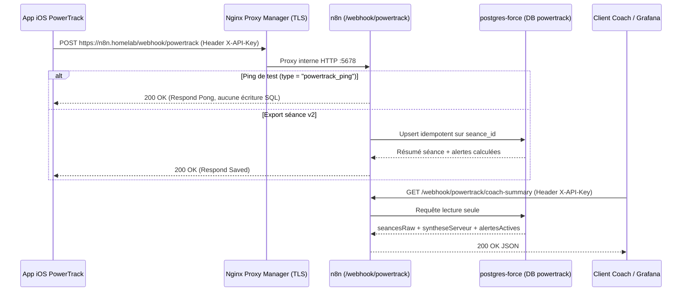

# Architecture du Homelab

## 1. Machines virtuelles Proxmox VE

| VMID | Nom | Rôle | RAM allouée | Disque système |
| :---: | :--- | :--- | :---: | :---: |
| `100` | `OPNsense-FW` | Pare-feu, routage inter-réseaux et serveur VPN WireGuard | 2 Go | 32 Go |
| `101` | `Serveur-Linux` | Hôte Ubuntu / Docker hébergeant l'ensemble des stacks applicatives | 4 Go | 50 Go |

---

## 2. Réseau, DNS et chiffrement TLS interne

### Réseau Docker partagé (`homelab-net`)
- Le réseau bridge `homelab-net` est déclaré par [`stacks/core/docker-compose.yml`](../stacks/core/docker-compose.yml) et consommé en tant que `external: true` par les autres stacks.
- **Isolation PostgreSQL :** Le conteneur `postgres-force` n'expose pas le port `5432` sur l'hôte Linux. Seuls les conteneurs membres de `homelab-net` (`n8n`, `metabase`, etc.) peuvent s'y connecter en interne.
- **Interfaces d'administration restreintes :** L'interface Web de Nginx Proxy Manager (`:81`) et celle de Prometheus (`:9090`) ne sont bindées que sur `127.0.0.1` côté hôte et sont accessibles via reverse proxy HTTPS ou tunnel SSH.

### Résolution DNS et PKI privée (`*.homelab`)
1. **DNS (`adguard-home`) :** Résout les noms de domaine internes `*.homelab` sur le réseau local et à travers le tunnel WireGuard.
2. **Autorité de certification interne (`pki/ca.cnf`) :** Définit l'autorité racine `Ethan Homelab Root CA` (`C = FR`, `O = Homelab`). La clé privée de la CA reste strictement hors Git sur le serveur.
3. **Certificat serveur multi-domaines (`pki/leaf.cnf`) :** Couvre les SAN suivants :
   `n8n.homelab`, `gitea.homelab`, `grafana.homelab`, `npm.homelab`, `adguard.homelab`, `metabase.homelab`, `prometheus.homelab`, `opnsense.homelab`, `proxmox.homelab`, `homelab`, `anisette.homelab`.
4. **Terminaison TLS (`nginx-proxy-manager`) :** Présente le certificat wildcard/SAN signé par la Root CA et transfère les requêtes en HTTP interne sur `homelab-net`. Les postes et l'iPhone ne doivent faire confiance qu'au certificat public racine (`homelab-root-ca.crt`).

---

## 3. Pipeline de post-traitement PowerTrack

L'application iOS **PowerTrack** fonctionne hors-ligne en salle et synchronise les séances validées vers le serveur homelab :

### Composants SQL ([`init-powertrack.sql`](../stacks/carnet-force/init-powertrack.sql))
- Tables principales : `seances` (clé primaire `seance_id`), `ressentis_seances`, `series_effectuees`.
- Calculs côté base : e1RM, tonnages, synthèses hebdomadaires (`v_seances_synthese`, `v_synthese_hebdo`), fenêtres de progression SBD, récupération glissante, suivi des douleurs sur 30 jours et alertes actives.
- **Accès lecture seule :** Les endpoints d'analyse et tableaux de bord s'appuient sur le rôle PostgreSQL restreint `powertrack_ro`.

---

## 4. Superviseur système et monitoring

La stack [`stacks/monitoring/docker-compose.yml`](../stacks/monitoring/docker-compose.yml) regroupe :
- **`node-exporter`** : collecte les métriques système de `Serveur-Linux` (`/proc`, `/sys`, `/` en lecture seule).
- **`cadvisor`** : collecte l'utilisation CPU, RAM et réseau par conteneur Docker (`--docker_only=true`, connecté à `default` et `homelab-net`).
- **`prometheus`** : interroge `localhost:9090`, `node-exporter:9100` et `cadvisor:8080` toutes les `15s` ([`prometheus.yml`](../stacks/monitoring/prometheus.yml)).
- **`grafana`** : exposé derrière `https://grafana.homelab` avec persistance dans `grafana_data` et deux dashboards ([Système Node Exporter](../stacks/monitoring/dashboards/node-exporter.json) et [Conteneurs cAdvisor](../stacks/monitoring/dashboards/docker-cadvisor.json)).

---

## 5. Portail d'accueil (`https://homelab`)

La stack [`stacks/homepage/docker-compose.yml`](../stacks/homepage/docker-compose.yml) exécute **Homepage** sur `homelab-net` :
- **Exposition HTTPS :** résolu localement via une réécriture AdGuard dédiée (`homelab`) et routé par Nginx Proxy Manager avec le certificat SAN (`npm-1`).
- **Widgets & supervision :** affiche les ressources système de `Serveur-Linux` (CPU, RAM, disque `/`, uptime), interroge `/var/run/docker.sock` en lecture seule (`:ro`) pour chaque conteneur, et intègre les widgets temps réel **Proxmox VE** (token lecture seule `PVEAuditor` via `.env`), **AdGuard Home** et **Prometheus**.

---

## 6. Automatisation Discord (`n8n`) et mises à jour de sécurité

- **Mises à jour de sécurité APT :** `unattended-upgrades` complété par [`system/51homelab-unattended`](../system/51homelab-unattended) (nettoyage automatique des paquets inutilisés, sans redémarrage automatique).
- **Surveillance & veille automatisées :**
  - [`homelab-alerts.json`](../stacks/n8n/workflows/homelab-alerts.json) : contrôle toutes les 10 minutes les services sur `homelab-net` + PostgreSQL, et n'alerte Discord qu'en cas de changement d'état (anti-spam).
  - [`homelab-backup-alert.json`](../stacks/n8n/workflows/homelab-backup-alert.json) : webhook sécurisé (`X-API-Key`) utilisé par [`homelab-health-alert.sh`](../backups/homelab-health-alert.sh) lors des alertes `OnFailure` de backup ou du contrôle quotidien `08:00` (fraîcheur backup < 26 h, certificat `wildcard.homelab.crt` > 30 j, disque < 85 %).
  - [`homelab-veille-ia-cyber.json`](../stacks/n8n/workflows/homelab-veille-ia-cyber.json) : veille hebdomadaire publiée chaque dimanche à `10:00` (`Europe/Paris`) sur Discord sous la forme d'un **unique message vocal natif (`flags: 8192`) de 2 à 3 minutes** (sans texte ni URL en dessous), couvrant **IA**, **Cybersécurité (CERT-FR / Krebs / etc.)** et **Ingénierie informatique / Tech (InfoQ, Ars Technica, etc.)**. Le script podcast est rédigé en français par `gemini-3.5-flash`, synthétisé en audio par `gemini-2.5-flash-preview-tts` (voix `Aoede`), puis converti en `OGG Opus` (`48 kHz` mono + forme d'onde) et téléversé vers Discord par le sidecar interne [`stacks/tts/`](../stacks/tts/docker-compose.yml) (`homelab-tts` sur `homelab-net`).
